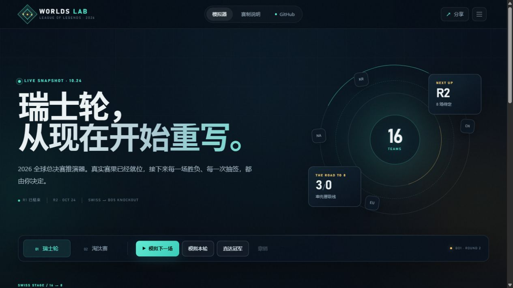

# Worlds Lab 26

英雄联盟 2026 全球总决赛瑞士轮与淘汰赛推演器。界面参考 [majors.im](https://majors.im/2026/cologne) 的赛事推演思路，围绕 LoL 的 Bo1/Bo3 瑞士轮和 Bo5 淘汰赛重新设计。

在线使用：[xiangchanghai123-alt.github.io/worlds-2026-lab](https://xiangchanghai123-alt.github.io/worlds-2026-lab/)



## 功能

- 默认载入 2026 年 10 月 24 日的真实赛果快照：瑞士轮第 1 轮完赛、第 2 轮抽签已确定。
- 点击任意战队即可手动决定胜者，也可以让系统模拟下一场、本轮或完整赛事。
- 自动按相同战绩配对，尽量避免重复交手，并按 3 胜晋级、3 负淘汰推进。
- 八强自动生成，支持四分之一决赛、半决赛和总决赛 BO5 推演。
- 本地自动保存、撤销、JSON 导入/导出，以及包含完整推演的分享链接。
- 纯静态网站，无构建依赖；支持 GitHub Pages 和浏览器安装为独立窗口应用。

## 本地运行

Windows 直接双击 `start-local.bat`，或双击 `index.html`。

也可以在目录中启动一个静态服务器：

```powershell
python -m http.server 8080
```

然后打开 `http://localhost:8080`。

## 发布到 GitHub Pages

1. 新建 GitHub 仓库，并上传本目录全部文件。
2. 进入仓库 `Settings → Pages`。
3. 在 `Build and deployment` 中将 Source 设为 `GitHub Actions`。
4. 推送到 `main` 分支后，`.github/workflows/pages.yml` 会自动部署。

站点地址通常为：

```text
https://<你的用户名>.github.io/<仓库名>/
```

## 更新真实赛果

打开 `data.js`：

- 在 `teams` 中修改战队名称、赛区、颜色或内置强度。
- 在 `actualMatches` 中把第 2 轮比赛填入 `scoreA`、`scoreB`，并将 `status` 改为 `final`。
- 也可以直接在网页上点击胜者，再从右上角菜单导出 JSON 备份。

`data.js` 默认使用 BO1 比分；后续晋级战/淘汰战可以通过 `bo: 3` 或 `bo: 5` 指定系列赛长度。

## 数据与声明

默认快照截至 2026-10-24，参考 Riot Games / LoL Esports 赛程、Liquipedia 与 Leaguepedia。实际比赛信息请以官方发布为准。

这是非 Riot Games 官方产品。战队 Logo 仅用于队伍识别，相关商标与图片权利归各战队及权利方所有。
